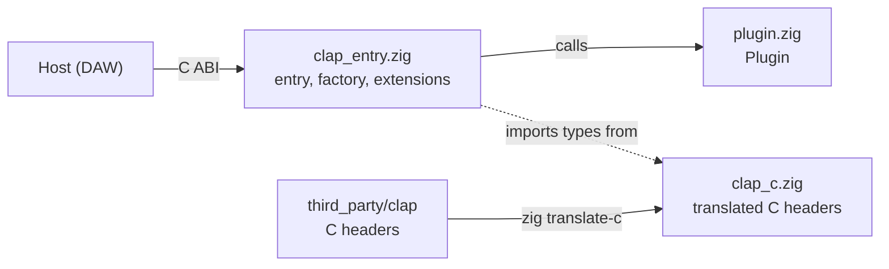

<div align="center">

# zig-clap-template

**Write [CLAP](https://github.com/free-audio/clap) audio plugins in Zig.**<br>
One struct for your DSP, a Makefile that produces a loadable plugin, and a script that stamps out new projects.

<br>


</div>

<br>

## Quickstart

You only need the script. It downloads the template itself.

```sh
curl -fsSLO https://raw.githubusercontent.com/YOUR_USER/zig-clap-template/main/new-plugin.sh
bash new-plugin.sh
```

It asks a few questions. Every one has a default, so Enter is a valid answer.

```text
New CLAP plugin from zig-clap-template

Bundle/file name (letters and digits, e.g. MyReverb) [MyPlugin]: MyReverb
Display name shown in the host [MyReverb]: My Reverb
Vendor [Example]: Acme
Unique plugin id (reverse-DNS) [com.acme.my-reverb]:
One-line description [A CLAP plugin written in Zig]: A small plate reverb
Vendor URL (may be empty) []:
Version [0.1.0]:
Create in directory [/home/you/my-reverb]:
```

Then build it:

```sh
cd my-reverb
make test      # unit tests for your DSP
make           # build/MyReverb.clap
make install   # copy it where your DAW looks
```

Rescan plugins in your host and **My Reverb** shows up as an audio effect with one stereo input, one stereo output and a Gain knob. Edit `src/plugin.zig` from there.

> [!NOTE]
> You need [Zig 0.17](https://ziglang.org/download/), `make`, `curl` and `tar`. On macOS, install the Xcode command line tools for `codesign`.

If you already cloned this repo, run `./new-plugin.sh` from the clone and it copies the local files instead of downloading.

<br>

## What you get

- A `Plugin` struct with `init`, `process` and `deinit`. It has no CLAP types in it, so it tests with plain slices.
- A working stereo gain effect with one automatable parameter, in dB, with text conversion for the host's UI.
- Every CLAP callback wired up: entry point, factory, lifecycle, `audio-ports` and `params`.
- A Makefile that produces a macOS `.clap` bundle (signed ad hoc) or a Linux `.so` named `.clap`.
- Vendored CLAP headers, so there is nothing to install or fetch at build time.
- A generator script that renames everything for you.

<br>

## How it fits together



The host loads the `.clap` file and looks up the exported symbol `clap_entry`. From there it asks the factory for a plugin instance and calls into the `clap_plugin_t` vtable. Each callback in `clap_entry.zig` finds the `Instance` stored in `plugin_data` and forwards to your `Plugin`.

<br>

## Project layout

| Path | What it is |
| --- | --- |
| `src/plugin.zig` | `Plugin` and its tests. **This is where your DSP goes.** |
| `src/clap_entry.zig` | `clap_entry`, the factory, the descriptor, and the `audio-ports` and `params` extensions. |
| `src/clap_c.zig` | The translated CLAP C types, plus `Instance`, the per-plugin state the host hands back to us. |
| `src/clap.h` | One line that includes `<clap/clap.h>`. Input for `zig translate-c`. |
| `third_party/clap/` | CLAP 1.2.10 headers and license (MIT). |
| `Makefile` | Build, test, install. |
| `Info.plist.in` | Template for the macOS bundle's `Info.plist`. |
| `new-plugin.sh` | The generator. |

<br>

## Writing your plugin

`Plugin` is the whole contract:

```zig
pub const Plugin = struct {
    gain_db: f32 = 0.0,

    pub fn init() Plugin { ... }

    /// One channel at a time. `input` and `output` are the same length and
    /// may alias, because hosts are allowed to process in place.
    pub fn process(self: *Plugin, input: []const f32, output: []f32) void { ... }

    pub fn deinit(self: *Plugin) void { ... }
};
```

| Method | Called | Thread |
| --- | --- | --- |
| `init` | Once, when the host initializes the plugin | Main |
| `process` | Once per channel per audio block | Audio |
| `deinit` | When the host destroys the plugin | Main |

`process` runs on the audio thread. Don't allocate, lock, or do I/O in it. State that the host can change while audio is running, like `gain_db`, is read and written with atomics (`gainDb` and `setGainDb`). Copy that pattern for your own parameters.

Tests live next to the code and run without a host:

```zig
test "0 dB leaves samples alone" {
    const input = [_]f32{ 1.0, -0.5, 0.25, 0.0 };
    var output = [_]f32{ 0.0, 0.0, 0.0, 0.0 };

    var p = Plugin.init();
    defer p.deinit();
    p.process(&input, &output);

    try std.testing.expectEqualSlices(f32, &input, &output);
}
```

<br>

## Make targets

| Command | Does |
| --- | --- |
| `make` | Translates the CLAP headers, then builds `build/<NAME>.clap`. |
| `make test` | Runs the Zig tests in `src/plugin.zig`. |
| `make install` | Copies the plugin to your user CLAP folder. |
| `make uninstall` | Removes it from there. |
| `make clean` | Deletes `build/`. |

Variables you can override, for example `make OPTIMIZE=Debug`:

| Variable | Default | Meaning |
| --- | --- | --- |
| `NAME` | set by the generator | File and bundle name. |
| `OPTIMIZE` | `ReleaseFast` | Any Zig optimize mode: `Debug`, `ReleaseSafe`, `ReleaseFast`, `ReleaseSmall`. |
| `ZIG` | `zig` | Path to the Zig compiler. |
| `INSTALL_DIR` | per platform | Where `make install` copies to. |

Install locations:

| Platform | Folder | Format |
| --- | --- | --- |
| macOS | `~/Library/Audio/Plug-Ins/CLAP` | Bundle: `Name.clap/Contents/{Info.plist,PkgInfo,MacOS/Name}` |
| Linux | `~/.clap` | Shared object named `Name.clap` |

Windows is not wired up. Zig can build the DLL, but the Makefile doesn't handle it yet.

<br>

## Going beyond a simple effect

The generator changes names and ids. It can't change what the plugin does, so anything past "per-channel effect with a few parameters" means editing `src/clap_entry.zig` too.

| You want | Where to change it |
| --- | --- |
| More parameters | `params` in `clap_entry.zig`: the count, `paramsGetInfo`, `paramsGetValue`, text conversion and `applyParamEvents`. Add the matching fields and atomics to `Plugin`. |
| Mono, or more than two channels | `audioPortsGet`, and the channel loop in `pluginProcess`. |
| Sidechain input | Add a second input port in `audioPortsCount` and `audioPortsGet`. |
| Effects that mix channels | `Plugin.process` takes one channel. Change it to take all channels, and update `pluginProcess`. |
| Anything that needs the sample rate | `pluginActivate` receives it and currently ignores it. Store it and pass it to `Plugin`. |
| A synth | Add the `note-ports` extension and handle note events. Neither exists yet. |
| Saved state | Add the `state` extension. Without it, hosts won't remember parameter values in a project. |
| A GUI | Add the `gui` extension. |

Parameter changes are applied at the start of each block, not at their exact sample offset. That's fine for gain. A plugin with zipper-sensitive parameters should split the block at each event's `header.time` and smooth the value.

<br>

## Why `translate-c`?

Zig 0.17 removed `@cImport`. The Makefile instead runs `zig translate-c` on `src/clap.h` and hands the result to the build as a module named `clap`:

```sh
zig translate-c -lc -Ithird_party/clap/include src/clap.h > build/clap.zig

zig build-lib -dynamic -lc -O ReleaseFast \
    --dep clap -Mroot=src/clap_entry.zig -Mclap=build/clap.zig \
    -femit-bin=build/MyReverb.clap/Contents/MacOS/MyReverb
```

The generated `build/clap.zig` is not committed. It regenerates whenever a header changes.

To upgrade CLAP, replace `third_party/clap/include` with the newer headers and update `third_party/clap/VERSION`.

<br>

## Testing in a host

`make test` covers your DSP. It can't tell you whether the plugin loads in a DAW or follows the CLAP spec. For that, install it and scan in your host, and consider running [clap-validator](https://github.com/free-audio/clap-validator) against `build/<NAME>.clap`.

<br>

## Notes

- **Generated projects are snapshots.** A fix made here later won't reach plugins you've already generated.
- **macOS signing.** The bundle gets an ad hoc signature (`codesign --sign -`). That's enough to load locally. To distribute it, sign with your Developer ID and notarize.
- **Plugin ids must be unique.** Two plugins with the same `id` will confuse hosts. The generator suggests `com.<vendor>.<name>`.

<br>

## Credits

The CLAP headers in `third_party/clap` are © the CLAP authors and used under the MIT license, included alongside them. See [free-audio/clap](https://github.com/free-audio/clap).
